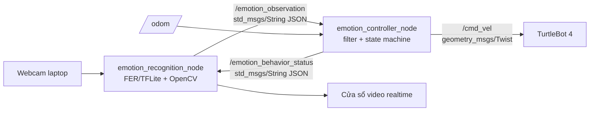

# Thiết kế nhận diện biểu cảm và điều khiển TurtleBot 4

## Mục đích

Xây dựng một ROS 2 package độc lập phục vụ bài thực hành: lấy hình ảnh trực tiếp từ webcam laptop, nhận diện biểu cảm khuôn mặt theo thời gian thực và điều khiển TurtleBot 4 bằng `/cmd_vel`. Dự án mới nằm trong `tbe4_face_recognition`, chạy được trước hết với TurtleBot 4 Simulator trên Ubuntu 22.04/ROS 2 Humble, đồng thời giữ giao diện ROS chuẩn để có thể dùng với robot thật sau khi kiểm tra an toàn.

`tb4_nav2` là nền tham khảo chính cho cấu trúc ament Python, TurtleBot 4 launch, virtualenv AI, script build/run và cách kiểm thử. Dự án cũ không bị sửa đổi. Các ý tưởng watchdog và chuyển động dựa trên odometry của `tb4_hand_gesture` có thể được chuyển thể ở mức nhỏ vì chúng giải quyết đúng rủi ro của `/cmd_vel`; không sao chép state machine cử chỉ tay.

## Mục tiêu

- Nhận diện sáu biểu cảm `happy`, `sad`, `neutral`, `angry`, `surprise`, `fear` từ webcam.
- Hiển thị video trực tiếp với khung khuôn mặt, nhãn, confidence, trạng thái ổn định và hành động robot.
- Ánh xạ biểu cảm sang sáu hành động quy định và thực hiện mỗi hành động một lần sau khi biểu cảm ổn định.
- Tách inference khỏi điều khiển robot để TensorFlow/FER không chặn vòng điều khiển hoặc watchdog.
- Dừng robot khi nhận `neutral`, mất khuôn mặt, mất heartbeat, mất odometry, camera lỗi hoặc node đóng.
- Có chế độ preview mặc định để kiểm tra webcam và logic mà không làm robot chuyển động.
- Có kiểm thử tự động cho lọc biểu cảm, state machine và profile chuyển động, cùng hướng dẫn chạy mô phỏng rõ ràng.

## Ngoài phạm vi

- Không nhận diện danh tính, tuổi, giới tính hoặc chủng tộc.
- Không dùng camera OAK-D trên robot cho phiên bản đầu; nguồn ảnh là webcam laptop qua `cv2.VideoCapture`.
- Không chạy Nav2, SLAM, AMCL, YOLO hoặc đọc bản đồ.
- Không huấn luyện mô hình mới và không thu thập dataset khuôn mặt.
- Không điều khiển đồng thời bằng teleop, Nav2 hoặc một publisher `/cmd_vel` khác.
- Không bổ sung tránh vật cản riêng; người dùng phải chọn vùng thử nghiệm đủ trống.
- Không hỗ trợ nhiều khuôn mặt. Khi có số khuôn mặt khác một, robot dừng/không kích hoạt.

## Điều không được xảy ra

- Không để nhiễu giữa hai nhãn làm robot đổi hướng liên tục.
- Không tự lặp vô hạn một hành động khi người dùng giữ nguyên biểu cảm.
- Không để inference chậm hoặc camera treo giữ lại vận tốc khác zero.
- Không cài TensorFlow, FER hoặc OpenCV pip vào Python hệ thống của ROS 2.
- Không khởi chạy Nav2 cùng controller biểu cảm rồi để hai nguồn cùng ghi `/cmd_vel`.
- Không ghi video hoặc ảnh khuôn mặt xuống đĩa theo mặc định.

## Các phương án đã xem xét

### Một node chung

Một node mở webcam, chạy inference và publish `/cmd_vel`. Cách này có ít file nhưng callback inference có thể chặn watchdog, logic camera khó kiểm thử riêng và dependency TensorFlow phải sống cùng vòng điều khiển. Không chọn.

### Node nhận diện publish thẳng `/cmd_vel`

Cách ngắn nhất nhưng ghép nhãn AI nhiều nhiễu trực tiếp với chuyển động, thiếu một lớp xác nhận trạng thái và khó áp dụng dừng an toàn. Không chọn.

### Hai node ROS 2, FER và bộ điều khiển độc lập

Node nhận diện chạy bằng Python trong virtualenv, publish quan sát biểu cảm; node điều khiển chạy bằng Python ROS hệ thống, lọc trạng thái và publish `/cmd_vel`. Đây là phương án được chọn vì giữ dependency AI tách biệt, cho phép preview, kiểm thử logic thuần Python và duy trì watchdog ở 20 Hz dù inference chậm.

FER được chọn thay cho DeepFace vì bài chỉ cần bảy điểm cảm xúc của mô hình FER2013. FER hỗ trợ trực tiếp các nhãn cần thiết và TFLite; DeepFace cung cấp thêm nhiều chức năng ngoài phạm vi. Nhãn `disgust` có thể xuất hiện từ mô hình nhưng không ánh xạ sang chuyển động và được xử lý như `unsupported`, tức dừng/không kích hoạt.

## Kiến trúc



Node nhận diện sở hữu webcam và cửa sổ OpenCV. Node này chụp và hiển thị khung hình khoảng 20 Hz, nhưng giới hạn inference ở 5 Hz để CPU vẫn đáp ứng. Nó chọn kết quả chỉ khi có đúng một khuôn mặt, vẽ overlay và chỉ publish một observation sau khi một lần inference mới hoàn thành. Vì vậy inference bị treo cũng làm observation hết hạn và controller dừng; frame camera lặp lại không thể giữ robot chạy bằng kết quả cũ. Node điều khiển không import FER/TensorFlow; nó nhận JSON, xác thực dữ liệu, lọc nhãn và chạy chuyển động từ odometry.

Topic `/emotion_observation` dùng `std_msgs/msg/String` với JSON ổn định:

```json
{"emotion":"happy","confidence":0.91,"face_count":1,"sequence":42,"session_id":"a1b2c3d4"}
```

`emotion` nhận một trong bảy nhãn FER hoặc `unknown`; `confidence` nằm trong `[0, 1]`; `face_count` là số khuôn mặt; `sequence` tăng theo mỗi lần inference; `session_id` là mã ngẫu nhiên được tạo một lần khi recognition node khởi động. Controller yêu cầu sequence tăng trong cùng session. Khi session đổi, controller lập tức dừng, xóa filter/latch và chỉ nhận lệnh mới sau khi neutral/no-face đã re-arm. JSON giúp tránh tạo custom message package cho một bài thực hành nhỏ nhưng vẫn mang đủ confidence và trạng thái khuôn mặt.

Topic `/emotion_behavior_status` cũng dùng JSON, gồm `state`, `stable_emotion`, `active_action`, `reason`, `preview_only`, `odometry_ready` và `motion_progress`. Recognition node dùng topic này để đưa trạng thái robot lên overlay; controller vẫn hoạt động nếu cửa sổ bị tắt.

## Nhận diện và ổn định biểu cảm

- Dùng `FER(use_tflite=True, mtcnn=False)` từ module `fer.fer` để không nạp nhánh MTCNN/PyTorch và giữ inference CPU gọn.
- Webcam mặc định `/dev/video0`, độ phân giải yêu cầu 640x480, mirror bật; index, width, height, mirror, cửa sổ và tần số inference là ROS parameters.
- Chỉ kết quả có đúng một khuôn mặt và confidence tối thiểu `0.55` mới là ứng viên hợp lệ.
- Chọn khuôn mặt duy nhất; không đoán người điều khiển khi có nhiều khuôn mặt.
- Một biểu cảm điều khiển phải xuất hiện liên tục ít nhất `0.5 s` trong các lần inference hợp lệ trước khi trở thành stable.
- `neutral` hợp lệ ra lệnh dừng ngay khi trở thành stable. Mất mặt, nhiều mặt, confidence thấp, `disgust`, payload sai hoặc heartbeat quá `0.75 s` đều dừng và hủy hành động.
- Observation chỉ làm mới watchdog khi có sequence mới trong session hiện tại. Sequence trùng/lùi bị bỏ qua; session mới buộc dừng và re-arm trước khi có thể chạy.
- Sau khi một hành động hoàn thành hoặc bị hủy, cùng biểu cảm không thể kích hoạt lại. Controller chỉ được arm lại sau khi `neutral` hoặc `unknown/no_face` ổn định `0.75 s`; sau đó một biểu cảm non-neutral mới có thể kích hoạt.
- Biểu cảm non-neutral khác xuất hiện trong khi robot chạy không xếp hàng hành động mới. Khi nó trở thành stable, hành động hiện tại bị dừng và controller chờ arm lại.

## Ánh xạ chuyển động

Mọi profile dùng odometry `/odom`, publish Twist ở 20 Hz và phát zero Twist ở các trạng thái không chạy. Giá trị mặc định ưu tiên demo chậm trong vùng trống:

| Biểu cảm | Hành động | Profile mặc định |
| --- | --- | --- |
| `happy` | Cong trái | Bán kính `0.40 m`, đổi hướng `+60°`, tốc độ thẳng tối đa `0.10 m/s` |
| `sad` | Cong phải | Bán kính `0.40 m`, đổi hướng `-60°`, tốc độ thẳng tối đa `0.10 m/s` |
| `neutral` | Dừng | Publish zero Twist, hủy profile hiện tại |
| `angry` | Lùi nhẹ | Lùi `0.20 m`, tốc độ tối đa `0.08 m/s` |
| `surprise` | Xoay một vòng | Quay trái `2π rad`, tốc độ tối đa `0.40 rad/s` |
| `fear` | Tiến nhẹ | Tiến `0.20 m`, tốc độ tối đa `0.10 m/s` |

Quãng đường được đo tương đối từ pose bắt đầu; góc quay được tích lũy qua điểm wrap `-π/π`. Mỗi profile có tolerance, thời gian settle ngắn và timeout `30 s`. Odometry cũ quá `0.5 s`, pose không hữu hạn, timestamp lùi, nhảy pose lớn hoặc timeout đều hủy chuyển động và publish zero Twist. Tất cả khoảng cách, góc, tốc độ, timeout và ngưỡng lọc nằm trong YAML để có thể tinh chỉnh mà không sửa mã.

`preview_only` mặc định là `true`. Trong preview, controller vẫn chạy filter/state machine, publish status và chỉ phát zero Twist. Khi một biểu cảm hợp lệ kích hoạt, status ghi nhận action ở trạng thái `preview_completed`, trigger được tiêu thụ và latch yêu cầu re-arm; controller không chờ odometry và không giả vờ chạy profile theo thời gian. Người dùng phải truyền `preview_only:=false` rõ ràng để bật chuyển động.

Nếu `preview_only=false` nhưng odometry chưa sẵn sàng, trigger bị từ chối với reason `odometry_unavailable`, được tiêu thụ và controller chuyển về trạng thái chờ re-arm. Hành động không được trì hoãn để tự chạy khi odometry xuất hiện sau đó.

## Cấu trúc dự kiến

```text
tbe4_face_recognition/
├── config/
│   ├── controller.yaml
│   └── recognition.yaml
├── docs/superpowers/
│   ├── plans/
│   └── specs/
├── launch/
│   ├── interaction.launch.py
│   ├── recognition.launch.py
│   └── simulation.launch.py
├── resource/tbe4_face_recognition
├── scripts/
│   ├── build.sh
│   ├── run_interaction.sh
│   ├── run_recognition.sh
│   └── setup_face_venv.sh
├── tbe4_face_recognition/
│   ├── __init__.py
│   ├── emotion_filter.py
│   ├── emotion_model.py
│   ├── emotion_recognition_node.py
│   ├── behavior.py
│   ├── motion.py
│   └── emotion_controller_node.py
├── test/
│   ├── test_behavior.py
│   ├── test_emotion_filter.py
│   ├── test_motion.py
│   └── test_package_assets.py
├── .gitignore
├── package.xml
├── requirements-face.txt
├── setup.cfg
├── setup.py
└── README.md
```

`emotion_model.py` là adapter nhỏ quanh FER để node và test có thể thay model bằng fake. `emotion_filter.py`, `behavior.py` và `motion.py` không phụ thuộc ROS/TensorFlow/OpenCV. Hai node chỉ làm nhiệm vụ adapter I/O, lifecycle và logging.

## Môi trường và vận hành

- Target: Ubuntu 22.04, Python 3.10, ROS 2 Humble, TurtleBot 4 Simulator/Ignition Fortress.
- `setup_face_venv.sh` tạo `.venv-face` với `--system-site-packages` để nhìn thấy `rclpy`, sau đó cài dependency AI đã pin trong virtualenv và kiểm tra import `fer`, TensorFlow Lite, OpenCV và `rclpy`.
- Recognition node được launch với executable Python của `.venv-face`; controller dùng ROS Python bình thường. Giao tiếp duy nhất giữa chúng là ROS topics chuẩn.
- `simulation.launch.py` chuyển thể cách include TurtleBot 4 bringup của `tb4_nav2`, nhưng đặt `nav2=false`, `slam=false`, `localization=false`; mặc định dùng world `warehouse` và không đóng gói map.
- `interaction.launch.py` chỉ mở hai node tương tác. Simulator được mở riêng để người dùng có thể chọn simulator hoặc robot thật mà không sửa launch tương tác.
- Script kiểm tra thiếu virtualenv/install và báo lệnh cần chạy. Không tự cài package hệ thống hoặc tự dùng `sudo`.

## Xử lý lỗi và đóng chương trình

- Camera không mở hoặc mất frame: recognition node publish một quan sát `unknown` nếu còn có thể, đóng camera/cửa sổ và thoát lỗi; controller dừng do observation hoặc heartbeat.
- FER/TensorFlow không nạp được: node báo hướng dẫn chạy setup script và không khởi động controller chuyển động ngoài preview.
- Payload JSON sai, giá trị không hữu hạn, sequence trùng/lùi hoặc nhãn lạ: controller hủy hành động với reason cụ thể. Session mới được chấp nhận sau khi dừng và reset filter, rồi yêu cầu re-arm.
- Nhấn `Q`, `Ctrl+C`, ROS shutdown hoặc exception: release webcam, destroy window và publish zero Twist trong cleanup của controller.
- Không có `/odom`: preview vẫn hiển thị trạng thái `odometry_ready=false`; motion mode từ chối kích hoạt và giữ zero Twist.

## Kiểm thử và tiêu chí hoàn thành

Kiểm thử tự động không cần webcam hay Gazebo:

- Adapter FER chọn nhãn/confidence đúng, xử lý không mặt/nhiều mặt và không import model khi test pure logic.
- Filter chỉ ổn định nhãn sau thời gian quy định, reset khi frame gap hoặc confidence thấp và không latch nhiễu.
- State machine kích hoạt đúng một lần, yêu cầu re-arm, ưu tiên neutral/unknown stop, không queue lệnh, không tự chạy lệnh từng bị chặn do thiếu odometry và hoàn tất preview theo quy ước.
- Protocol dừng khi observation hết hạn, từ chối sequence trùng/lùi trong cùng session và reset an toàn khi recognition node tạo session mới.
- Motion mô phỏng hoàn thành đúng khoảng cách/góc, xử lý yaw wrap, giới hạn vận tốc và dừng khi timeout/odom lỗi.
- Package cài đủ launch/config/scripts cần thiết và entry points đúng.

Kiểm thử tích hợp thủ công theo thứ tự:

1. Preview webcam: đủ sáu nhãn xuất hiện trên overlay, mất mặt/multiple faces hiện đúng trạng thái.
2. Topic: `/emotion_observation` và `/emotion_behavior_status` có heartbeat và payload hợp lệ.
3. Simulator: chỉ một publisher điều khiển, robot undock, `/odom` mới và `preview_only=false`.
4. Thử từng biểu cảm ở vùng trống; đo hành động hoàn thành một lần và dừng.
5. Trong khi chạy, thử neutral, mất mặt, đóng camera và pause/mất odom; `/cmd_vel` phải về zero trong timeout đã định.

Dự án hoàn thành khi build bằng colcon, toàn bộ test tự động pass, preview chạy được với webcam và sáu hành động được chứng minh trong TurtleBot 4 Simulator. Khả năng chạy robot thật được ghi là tương thích giao diện, không tuyên bố đã nghiệm thu nếu chưa kiểm thử trên phần cứng.

## Quyết định để người triển khai tự chọn

- Chi tiết màu sắc và bố cục overlay, miễn thông tin bắt buộc vẫn đọc được.
- Tên helper nội bộ và cách chia hàm nhỏ bên trong các module đã xác định.
- Phiên bản patch chính xác của dependency transitive nếu resolver cần điều chỉnh, với điều kiện Python 3.10 và các phiên bản top-level trong plan vẫn được giữ và import check pass.
